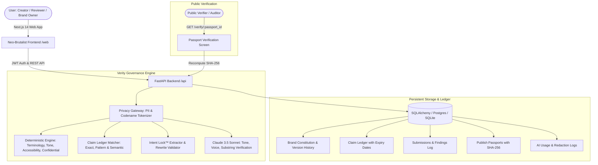

# Verity — Brand Governance Platform

> **"Brand governance that cites before it flags."**  
> *Brand errors caught before they are public.*

[](https://github.com)
[](https://github.com)
[-9DB0FF?style=for-the-badge&logoColor=111111&labelColor=111111)](https://github.com)
[](https://github.com)

---

## 1. What is Verity?

Verity is an autonomous brand governance platform built from scratch in a strict **Neo-Brutalist** visual style. It enforces brand guidelines, claim substantiations, tone hygiene, and privacy safeguards before publication.

Unlike traditional AI linters that produce opaque warnings, **Verity cites before it flags**:
1. **Names the exact rule or approved source** (e.g. `Rule T-1`, `Claim Ledger F-2`, `WCAG AA`).
2. **Explains why** the content breaks the rule.
3. **Suggests an intent-preserving fix** that keeps the creator's promotional goal intact.
4. **Humans always make the final call.**

---

## 2. Core Architecture



---

## 3. Key Differentiators

### A. Claim Ledger™ (Evidence Substantiation)
Verity detects numerical statistics, rankings, percentages, and attendee counts. It matches claims against the approved ledger:
- **`VERIFIED`**: Cites ledger ID (e.g. `F-1`), evidence source, owner desk, and expiration date.
- **`EXPIRES SOON`**: Warns creators if an approved claim expires within 30 days (e.g. `F-3`).
- **`EXPIRED`**: Flags claims citing outdated evidence (e.g. `F-2` expired in 2025).
- **`UNSUPPORTED`**: Blocks claims lacking documentation in the ledger.

### B. Intent Lock™ (Creator Intent Protection)
Before suggesting fixes, Verity locks the creator's `{goal, audience, key_message, tone, must_keep_phrases[], call_to_action}`. Every suggested rewrite is verified against the Intent Lock:
- If intent is preserved: displays `INTENT PRESERVED`.
- If a correction alters marketing meaning: alerts `INTENT AT RISK` with a safer alternative.

### C. Publish Passport™ (Cryptographic SHA-256 Receipt)
Upon authorized Reviewer approval, Verity computes a SHA-256 hash over:
`final_text + rules_version + approver_id + timestamp + ai_used + findings_summary`
A public verify page (`/verify/[id]`) recomputes the hash from the live copy to verify `VALID & UNTAMPERED` status and displays a scannable QR code.

### D. Guideline Health Radar™
Tracks creator rejection rates per rule. If a rule has $\ge 3$ decisions and $\ge 50\%$ reject rate, it is flagged as **UNCLEAR**. Verity drafts a clarified clause with approved & banned examples for Brand Owner sign-off, automatically incrementing rule versions.

### E. Zero-Leakage Privacy Gateway
Before calling Claude, Verity redacts confidential codenames (e.g. `Project Falcon`), emails, and phone numbers into synthetic tokens like `[REDACTED-CONFIDENTIAL-1]`. Tokens are restored server-side in suggested fixes.

---

## 4. Accuracy Benchmark Results

Run with:
```bash
python scripts/run_accuracy_check.py
```

```
=================================================================
  VERITY GOVERNANCE ENGINE — ACCURACY BENCHMARK SUITE
=================================================================
  Caught 12 of 12 planted errors.
  False flags on clean copy: 0
  Recall: 100.0%
  False Positive Rate: 0%
=================================================================
```

---

## 5. Quickstart & Local Run

### Prerequisites
- Node.js 18+ (tested on Node 20 / 24)
- Python 3.11+ (tested on Python 3.12)

### Option 1: Native Local Run (Zero External Dependencies)

#### 1. Start the FastAPI Backend:
```bash
cd api
python -m venv venv
# On Windows:
venv\Scripts\pip install -r requirements.txt
venv\Scripts\uvicorn app.main:app --port 8000 --host 127.0.0.1
# On Linux / macOS:
source venv/bin/activate
pip install -r requirements.txt
uvicorn app.main:app --port 8000 --host 127.0.0.1
```
*API is live at `http://localhost:8000` (OpenAPI docs at `http://localhost:8000/docs`).*

#### 2. Start the Next.js Frontend:
```bash
cd web
npm install
npm run dev
```
*Web application is live at `http://localhost:3000`.*

---

### Option 2: Docker Compose (Single Command)
```bash
docker compose up --build
```
- Web: `http://localhost:3000`
- API: `http://localhost:8000`

---

## 6. Environment Variables

| Variable | Default | Purpose |
|---|---|---|
| `DATABASE_URL` | `sqlite:///./verity.db` | PostgreSQL (Supabase/Neon) or SQLite fallback |
| `JWT_SECRET` | `verity-super-secret-jwt-key-braket-2026` | Token signing secret |
| `ANTHROPIC_API_KEY` | *(Optional)* | Claude 3.5 Sonnet brand voice review & clause drafting |
| `CLAUDE_MODEL` | `claude-3-5-sonnet-20241022` | Anthropic model identifier |
| `NEXT_PUBLIC_API_URL`| `http://localhost:8000` | Backend API URL for frontend |

---

## 7. Demo Guide for Judges (Zero Setup, Under 2 Minutes)

1. Open `http://localhost:3000`.
2. Click **"Enter Workspace"** under **CREATOR**.
3. Demo Post #1 (`NovaFest 2026 Campus Launch Announcement`) is loaded by default.
4. Click **"RUN VERITY GOVERNANCE CHECK"**:
   - Inspect the 7+ cited findings (confidential codename `Project Falcon`, casing `NovaFest`, value vocabulary `CHEAP`, expired citation `F-2`, guarantee prohibition, and exclamation spam).
5. Click **"Accept All"** or click **"Accept Fix"** on individual cards.
6. Notice the revised copy update below with the **`✓ INTENT PRESERVED`** badge.
7. Click **"SUBMIT FOR REVIEWER APPROVAL"**.
8. Switch to **REVIEWER** role in the top-right navbar and navigate to **"Approvals"**.
9. Click **"APPROVE & ISSUE PUBLISH PASSPORT"**.
10. Click **"Verify Receipt"** to open the public Passport page (`/verify/[id]`) and observe the **`VALID & UNTAMPERED`** cryptographic badge and scannable QR code!

---

## 8. Three Planned Future Improvements (Judging Weight: 15 pts)

1. **Multimodal Real-Time Figma & Canva Plugin**:
   - Live design canvas governance that calculates WCAG AA color contrast on active vector shapes, measures logo clear-space in pixels, and highlights banned font pairings directly inside creative workflows.
2. **Enterprise Claim Ledger Live Connectors (Snowflake & Salesforce)**:
   - Direct SQL/warehouse sync that automatically re-verifies public metrics against corporate data lakes, flagging expired claims the instant financial quarter or audit cycles close.
3. **Reinforcement Drift Learning from Reviewer Overrides**:
   - Fine-tuned policy feedback loop that clusters creator rejections and reviewer comments to suggest automated threshold updates and clause clarifications without manual committee meetings.

---

## 9. Team BraKet

- Product Name: **Verity**
- CodeAxis Round 2 ("The Build")
- Visual System: Neo-Brutalist (`#FFFBEF` cream, `#111111` ink, `#FFD93D` yellow, 3px solid borders, hard offset shadows).
