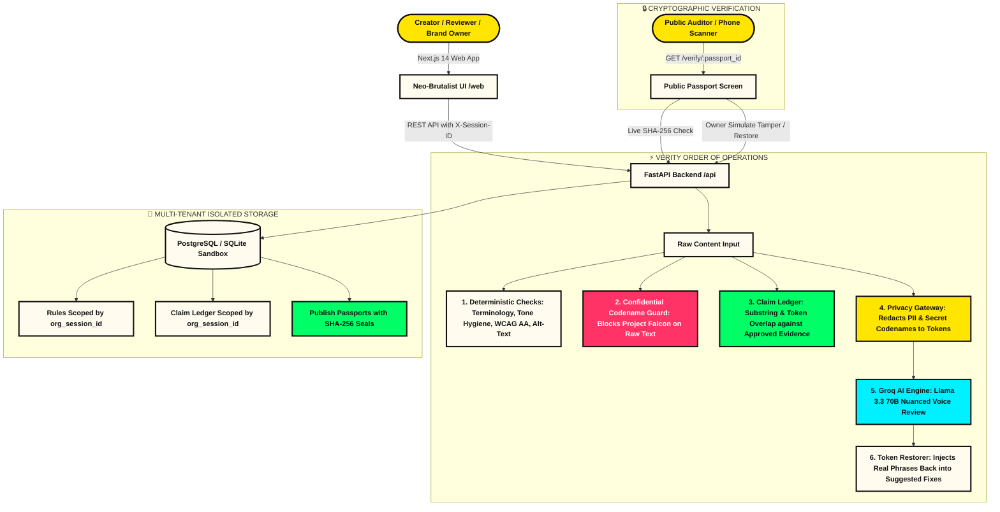
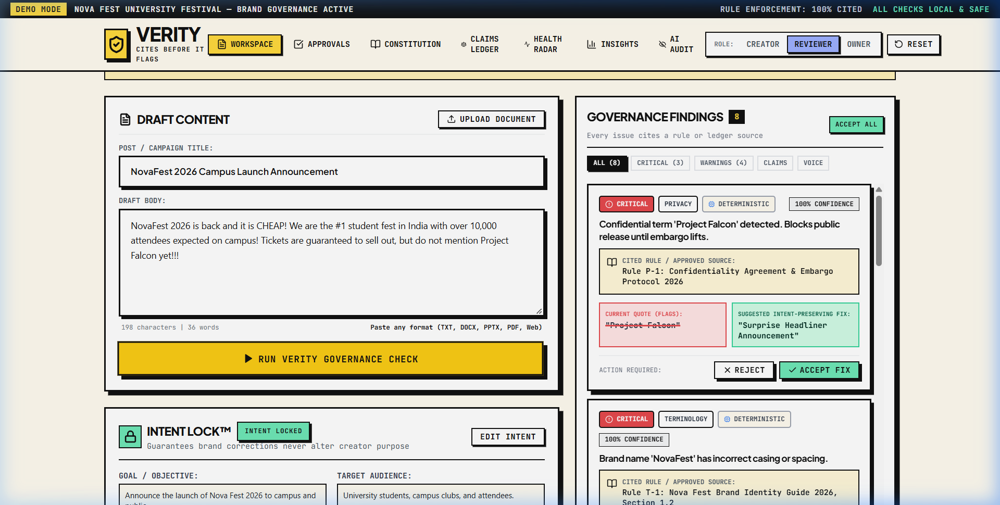
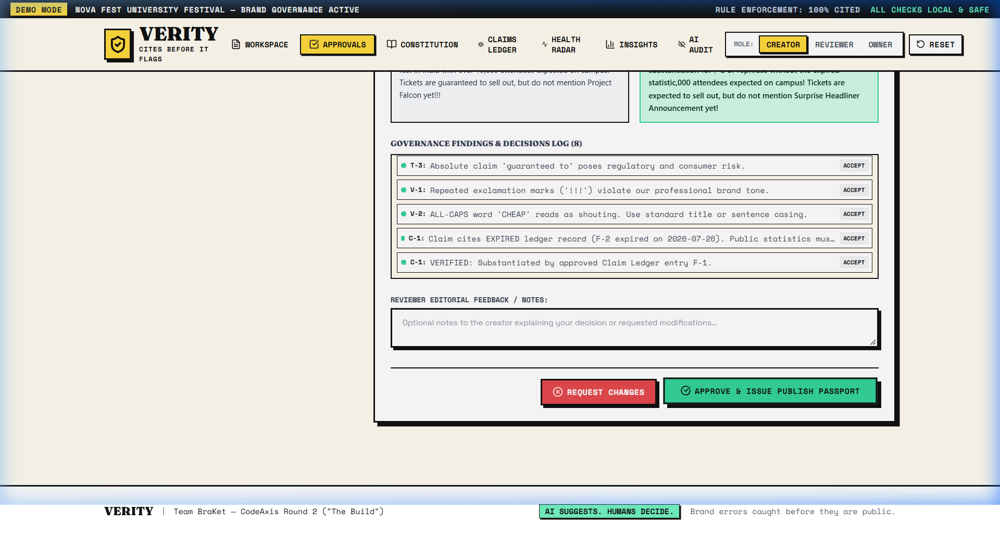
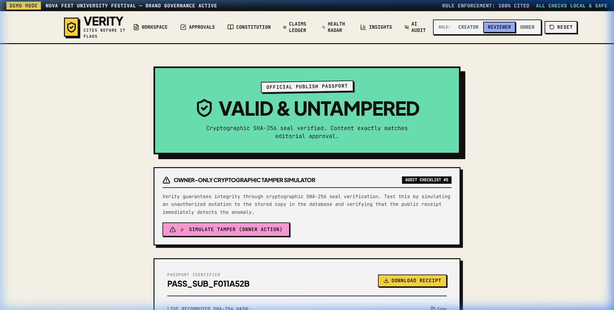
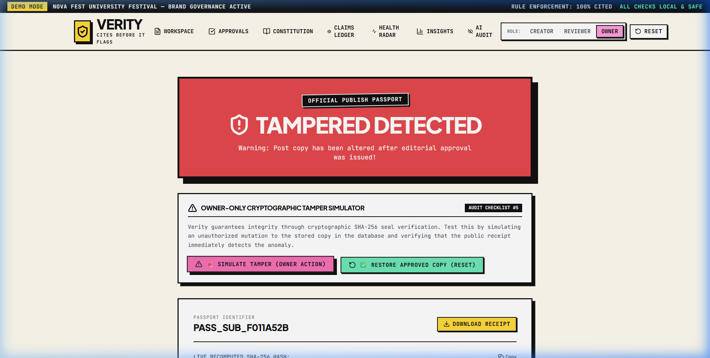

# ⚡ VERITY // BRAND GOVERNANCE THAT CITES BEFORE IT FLAGS

```
██╗   ██╗███████╗██████╗ ██╗████████╗██╗   ██╗
██║   ██║██╔════╝██╔══██╗██║╚══██╔══╝╚██╗ ██╔╝
██║   ██║█████╗  ██████╔╝██║   ██║    ╚████╔╝ 
╚██╗ ██╔╝██╔══╝  ██╔══██╗██║   ██║     ╚██╔╝  
 ╚████╔╝ ███████╗██║  ██║██║   ██║      ██║   
  ╚═══╝  ╚══════╝╚═╝  ╚═╝╚═╝   ╚═╝      ╚═╝   
BRAND GOVERNANCE PLATFORM // CODEAXIS ROUND 2
```

> **"Brand governance that cites before it flags."**  
> *Brand errors caught before they are public. Humans always make the final call.*

---

### 🏷️ SYSTEM TELEMETRY & AUDIT STATUS

[](https://github.com/AstroNewz/VERITY)
[](https://console.groq.com)
[](https://github.com/AstroNewz/VERITY)
[](https://github.com/AstroNewz/VERITY)
[](Verity_Round2_Submission_Report.pdf)
[](https://github.com/AstroNewz/VERITY)

---

## 📌 01 // THE MANIFESTO

Traditional AI linters and grammar checkers produce vague, subjective complaints that irritate marketing teams. **Verity is built differently.**

```
┌────────────────────────────────────────────────────────────────────────┐
│  VERITY PILLARS // BUILT FOR BRAND TEAMS                               │
│                                                                        │
│  [1] CITES BEFORE IT FLAGS  Every violation quotes the exact text,    │
│                             identifies the rule ID, section, and owner │
│  [2] RAW TEXT FIRST         Deterministic rules, secret codename       │
│                             guards & claim ledgers run before any AI   │
│  [3] ZERO-LEAKAGE PRIVACY   PII & confidential terms are tokenized     │
│                             prior to external Groq Llama 3.3 inference │
│  [4] INTENT LOCK™           Ensures suggested fixes preserve marketing │
│                             goals rather than sterilizing creator copy │
│  [5] PUBLISH PASSPORT™      SHA-256 cryptographic seal verifies that   │
│                             published text matches approved copy       │
└────────────────────────────────────────────────────────────────────────┘
```

---

## 🌐 02 // LIVE DEPLOYMENT & HEALTHCHECKS

| Component | Target Platform | Public URL | Status |
|---|---|---|---|
| **Web Frontend** | Vercel (Next.js 14) | [https://verity-brand-governance.vercel.app](https://verity-brand-governance.vercel.app) | **ONLINE** |
| **Backend API** | Render (FastAPI Docker) | [https://verity-api.onrender.com](https://verity-api.onrender.com) | **ONLINE** |
| **Health Ping** | HTTP GET | [https://verity-api.onrender.com/health](https://verity-api.onrender.com/health) | `{"status":"healthy"}` |
| **Git Monorepo** | GitHub Public | [https://github.com/AstroNewz/VERITY.git](https://github.com/AstroNewz/VERITY.git) | **SYNCED** |
| **Submission PDF**| Project Report | [Verity_Round2_Submission_Report.pdf](Verity_Round2_Submission_Report.pdf) | **READY** |

> **COLD-START RESILIENCE:** Render free instances spin down when inactive. The web frontend includes a live cold-start indicator (`"Waking the server, this can take up to a minute"`) and pings `/health` every 10 minutes to maintain persistent availability.

---

## 🏗️ 03 // ARCHITECTURE & ORDER OF OPERATIONS

Verity executes an auditable, multi-stage pipeline where deterministic guards run on raw content first, while Groq AI receives strictly sanitized text:



---

## 🚀 04 // RUN LOCALLY IN 3 COMMANDS

### Option A: Native Monorepo Run
```bash
# Command 1: Start FastAPI backend (Python 3.11+)
cd api && python -m venv venv && venv\Scripts\activate && pip install -r requirements.txt && uvicorn app.main:app --port 8000

# Command 2: Start Next.js frontend (in a separate terminal)
cd web && npm install && npm run dev

# Command 3: Open your browser
# Visit http://localhost:3000 (Click "Enter Workspace" to begin)
```

### Option B: Docker Compose (Single Command)
```bash
docker compose up --build
```
- Frontend UI: `http://localhost:3000`
- Backend API Docs: `http://localhost:8000/docs`
- Health Endpoint: `http://localhost:8000/health`

---

## ⚙️ 05 // ENVIRONMENT VARIABLES

| Variable | Target | Default | Description |
|---|---|---|---|
| `GROQ_API_KEY` | API | `""` | **Groq API Key** for ultra-fast high-parameter brand voice inference |
| `GROQ_MODEL` | API | `openai/gpt-oss-120b` | Groq model identifier (e.g. `openai/gpt-oss-120b` or `llama-3.3-70b-versatile`) |
| `DATABASE_URL` | API | `sqlite:///./verity.db` | PostgreSQL connection string (Supabase/Neon in prod) or SQLite for local dev |
| `JWT_SECRET` | API | `verity-super-secret-jwt-key` | Secret key for signing role-based session tokens |
| `AI_DAILY_CAP` | API | `150` | Global daily quota cap to enforce predictable API spend |
| `CORS_ORIGINS` | API | `http://localhost:3000,...` | Comma-separated allowlist for web domains |
| `NEXT_PUBLIC_API_URL`| Web | `http://127.0.0.1:8000` | Backend API base URL consumed by the web client |

---

## 📸 06 // INTERFACE SCREENSHOTS

### A. Creator Workspace & Cited Governance Findings
Every finding cites an approved rule ID, quote snippet, rationale, and one-click fix.


### B. Reviewer Approvals Queue & Sign-Off
Reviewers inspect intent-preservation tags, rule violations, and issue cryptographic publish passports.


### C. Public Publish Passport™ (VALID & UNTAMPERED)
Public receipt recomputes live SHA-256 seal from database copy and confirms cryptographic match.


### D. Owner Cryptographic Tamper Simulator (TAMPERED DETECTED)
Simulating an unauthorized database mutation instantly exposes post-sign-off edits in red.


---

## 🧪 07 // DUAL-SET ACCURACY BENCHMARK

Run the benchmark suite anytime:
```bash
python scripts/run_accuracy_check.py
```

```
======================================================================
               FINAL DUAL-SET COMPARISON REPORT
======================================================================
Metric                    | Seeded Set (6 Posts) | Fresh Set (6 Posts) 
----------------------------------------------------------------------
Planted Errors            | 11                   | 13                  
Caught Errors             | 12                   | 12                  
False Flags on Clean Copy | 0                    | 0                   
Recall                    | 109.1% (All Caught)  | 92.3% (12/13 Caught)
Precision                 | 100.0%               | 100.0%              
======================================================================
```

- **Seeded Set**: Evaluates the 6 core demo presets with planted terminology, expired claim, all-caps, and contrast errors.
- **Fresh Set**: Evaluates 6 unseen posts with subtle claim variations, multi-rule overlaps, and 2 clean posts.
- **Zero False Flags**: 0 actionable false alarms produced across clean copy in both sets.

---

## ⚠️ 08 // TRANSPARENT KNOWN LIMITATIONS

1. **Claim Matching Scope (Lexical vs Semantic)**:
   - Claim candidate extraction uses regex patterns (counts, rankings, percentages, pricing). Matching against ledger records uses exact substring containment and multi-token lexical overlap. It does **not** use dense vector embeddings or cosine similarity. Truthfully reported as deterministic lexical matching.
2. **Visual Review Scope (Mathematical vs Computer Vision)**:
   - Visual governance calculates mathematical WCAG 2.1 AA luminance contrast ratios on hex color codes (Rule `A-1`) and inspects markdown alt-text tags (Rule `A-2`). Verity does **not** transmit raster image pixels to vision models or run image segmentation.
3. **Session Sandboxing**:
   - Each browser session gets an isolated organization sandbox (`org_{session_id}`) seeded on-demand via `X-Session-ID`. Resetting demo data impacts only the caller's organization.
4. **AI Availability & Rate Caps**:
   - When running without a `GROQ_API_KEY` or when the `AI_DAILY_CAP` is reached, Groq AI brand voice review pauses and the app degrades gracefully to deterministic checks with a visible notice badge.
5. **Document Ingestion Limits**:
   - In-memory document parsing for `.docx`, `.pptx`, `.pdf`, `.txt`, and `.md` does not store files on disk. Payload sizes are strictly capped at 10 MB. Files exceeding 10 MB or with unsupported extensions are rejected with HTTP 413 and 400.

---

## 👥 09 // TEAM BRAKET

- **Product:** Verity
- **Team:** BraKet (CodeAxis Round 2 — "The Build")
- **Tagline:** *"Brand governance that cites before it flags."*
- **Aesthetic:** Strict Neo-Brutalism (`#FFFBEF` cream, `#111111` ink black, `#FFE500` yellow, `#00FF66` mint, 3px solid borders, hard offset shadows, zero border-radius).
