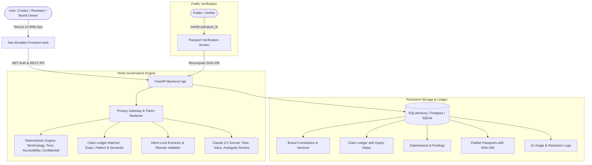

# Verity — Architecture & Implementation Plan
**Tagline:** "Brand governance that cites before it flags."  
**Promise:** "Brand errors caught before they are public."  
**Team:** BraKet | **Round:** CodeAxis Round 2 ("The Build")

---

## 1. System Architecture

---

## 2. Monorepo Directory Tree

- `/api`: FastAPI Python 3.11/3.12, Pydantic v2, SQLAlchemy 2, SQLite/PostgreSQL, Claude Anthropic SDK, Pytest
- `/web`: Next.js 14+ App Router, TypeScript, Tailwind CSS, Neo-Brutalist design tokens
- `/docs`: Architecture, Features, API guide
- `/scripts`: Automated accuracy check benchmark
