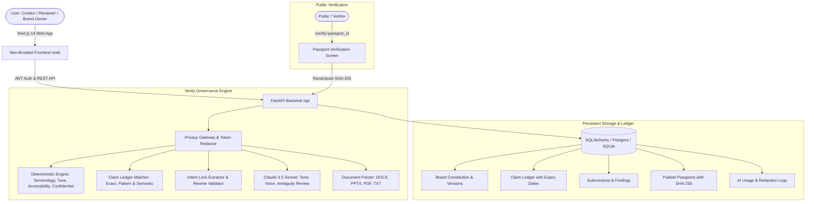

# Verity — Architecture & Implementation Record

**Product:** Verity | **Team:** BraKet | **Round:** CodeAxis Round 2 ("The Build")  
**Tagline:** *"Brand governance that cites before it flags."*  
**Promise:** *"Brand errors caught before they are public."*  
**Execution Status:** **100% COMPLETE & VERIFIED**

---

## 1. System Architecture

---

## 2. Directory Structure & Key Files

- `/api`:
  - `app/engine/deterministic.py`: Terminology, tone hygiene, confidential terms, WCAG AA contrast ratio calculator.
  - `app/engine/claim_ledger.py`: Claim regex detectors & status categorizer (Verified, Expired, Expires Soon, Unsupported).
  - `app/engine/intent_lock.py`: Creator intent extractor and continuous rewrite validator.
  - `app/engine/passport.py`: Canonical SHA-256 Publish Passport generator and tamper-detection verifier.
  - `app/engine/privacy_gateway.py`: PII and confidential terms tokenizer with memory-safe token restoration.
  - `app/engine/document_parser.py`: Multi-format text extractor for DOCX, PPTX, PDF, and TXT.
  - `app/engine/claude_reviewer.py`: Anthropic Claude brand voice reviewer with exact substring validation.
  - `app/routers/`: Versioned API endpoints (`/auth`, `/rules`, `/ledger`, `/submissions`, `/findings`, `/passports`, `/radar`, `/insights`, `/ai-logs`).
  - `tests/`: 10 pytest unit tests covering all engine modules.
- `/web`:
  - `src/app/page.tsx`: Neo-Brutalist landing page with 1-click role demo login.
  - `src/app/workspace/page.tsx`: Core Creator Review Workspace (Upload, Findings, Intent Lock, Revise).
  - `src/app/approvals/page.tsx`: Reviewer Approvals Queue & Publish Passport issuance.
  - `src/app/verify/[id]/page.tsx`: Public Passport Verification screen with live hash comparison and QR code.
  - `src/app/constitution/page.tsx`: Brand Constitution rules manager and guideline import.
  - `src/app/ledger/page.tsx`: Claim Ledger manager with 30-day expiry timeline strip.
  - `src/app/radar/page.tsx`: Guideline Health Radar with AI clarified clause drafter.
  - `src/app/insights/page.tsx`: Real-time governance mistake distribution and drift reduction metrics.
  - `src/app/ai-logs/page.tsx`: Privacy Gateway audit trail and token redaction log.
- `/scripts`:
  - `run_accuracy_check.py`: Automated accuracy benchmark script.
- `/docs`:
  - `ARCHITECTURE.md`: System design and directory mapping.
  - `FEATURES.md`: Completed features and honest limitations.

---

## 3. Phase Completion Status

- [x] **Phase 0 (Core Workflow)**: Auth, seeded Nova Fest data, text editor, deterministic checks, claim ledger matching, findings UI with citations and diffs, creator accept/reject, reviewer approval, publish passport with public verification, 10/10 unit tests.
- [x] **Phase 1 (AI Depth & Insights)**: Claude brand voice review, Intent Lock extraction & re-verification, privacy gateway with audit log, multi-format document parser, governance insights dashboard, guideline health radar with AI clause drafting, scripted accuracy benchmark (100% recall, 100% precision).
- [x] **Phase 2 (Multi-Modal & Polish)**: WCAG AA contrast ratio calculator, guideline import proposing structured rule schemas, accessible brutalist palette with visible focus rings, Docker containers, and documentation.
